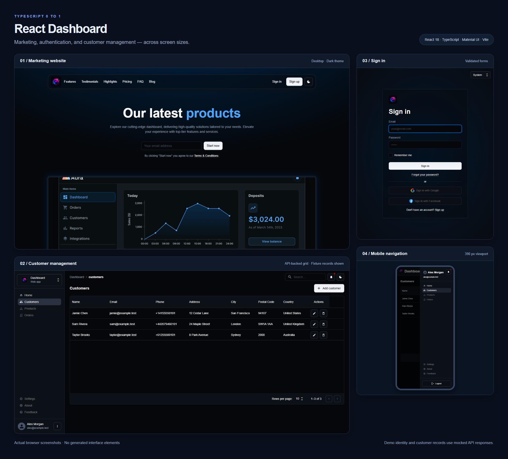
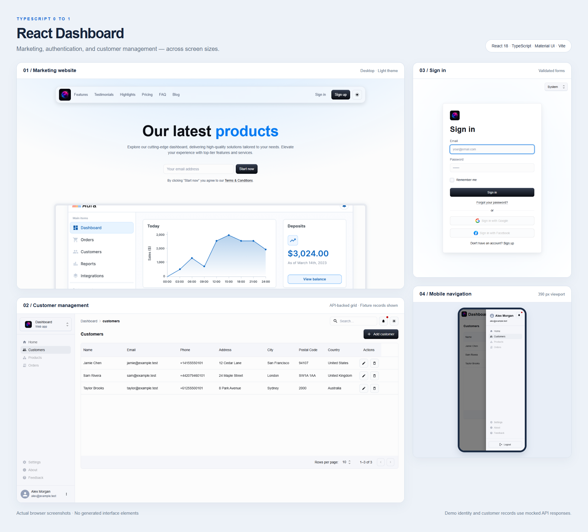
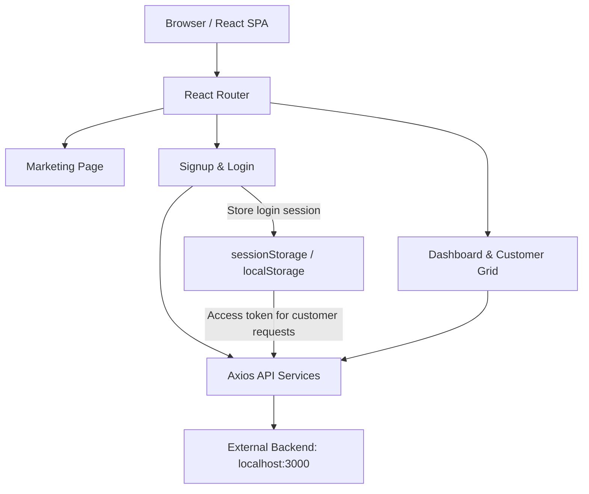

# 📊 React Dashboard — TypeScript 0 to 1

[](https://react.dev/)
[](https://www.typescriptlang.org/)
[](https://vite.dev/)
[](https://mui.com/)

A React and TypeScript learning project combining a marketing website, user registration and login, and a customer dashboard. Built with **Vite**, **Material UI**, **React Router**, and **Axios**, the frontend demonstrates reusable components, typed API services, and a shared application theme.

## 🖼️ Application Preview

**Dark theme**



<details>
<summary>Light theme preview</summary>



</details>

Actual browser screenshots. The dashboard uses fictional identities and mocked API responses for this preview; the running application connects to your configured backend.

---

## 📐 Architecture & Flow

The browser renders a React single-page application and calls a separate HTTP backend for authentication, users, and customers. Backend code is not included in this repository.



---

## ✨ Key Features

* **🏠 Marketing Website** — Landing page with features, highlights, testimonials, pricing, and FAQ sections.
* **🔐 Registration & Login** — Validated forms, request progress, visible errors, optional remembered sessions, and expiry/401 handling.
* **📊 Dashboard Overview** — Summary cards for users, customers, and products using sample statistics and charts.
* **👥 Customer Grid** — Backend-backed create, edit, and delete actions, pagination, deletion confirmation, loading indicators, and retryable errors.
* **🎨 Shared Theme** — Material UI customization with light and dark color schemes and responsive layouts.
* **🧩 Typed API Layer** — Separate authentication, user, and customer services with TypeScript DTOs.
* **⚡ Development Tooling** — Vite with SWC, hot module replacement, TypeScript checking, and ESLint.

---

## 📂 Repository Structure

```text
frontend_react_p8/                  # Application directory
├── docs/screenshots/              # Individual captures and README composite
├── tests/                         # Playwright regression tests and capture workflow
├── public/                        # Public static assets
├── src/
│   ├── api/
│   │   ├── auth/                  # Login service, session state, and auth hook
│   │   ├── customers/             # Customer service and DTOs
│   │   ├── users/                 # User service and DTOs
│   │   ├── http.ts                # Authenticated requests and shared errors
│   │   └── apiconfig.ts           # Configurable backend endpoints
│   ├── pages/
│   │   ├── app/                   # Vite + React counter demo
│   │   ├── dashboard/             # Dashboard, customer grid, and widgets
│   │   ├── login/                 # Login and reset-password dialog
│   │   ├── marketing/             # Landing page, sections, and assets
│   │   └── signup/                # Registration page
│   ├── theme/                     # Shared theme and component overrides
│   ├── main.tsx                   # React entry point and providers
│   └── routes.tsx                 # Browser routes
├── eslint.config.js               # Lint configuration
├── index.html                     # HTML entry point
├── package.json                   # Dependencies and scripts
├── .env.example                   # Optional API base URL configuration
├── playwright.config.ts           # Browser test configuration
├── package-lock.json              # npm lockfile
├── pnpm-lock.yaml                 # pnpm lockfile
├── tsconfig*.json                 # TypeScript configuration
├── vite.config.ts                 # Vite and React SWC configuration
└── README.md
```

---

## 🚀 Getting Started

### Prerequisites

* **Node.js and npm** compatible with the project's Vite 6 dependencies.
* A running backend implementing the endpoints below for registration, login, and customer loading.

### Local Development Setup

1. **Open the application directory.** From the workspace folder containing the nested project:

   ```bash
   cd frontend_react_p8
   ```

   Run the remaining commands in the directory containing `package.json`.

2. **Install dependencies:**

   ```bash
   npm install
   ```

3. **Configure the backend URL.** The default is `http://localhost:3000/v1/api`. To use a different backend, create `.env.local` in the application directory:

   ```dotenv
   VITE_API_BASE_URL=http://localhost:3000/v1/api
   ```

   See `.env.example`. Restart Vite after changing configuration. Configure the backend to allow requests from the frontend's origin through CORS.

4. **Start the development server:**

   ```bash
   npm run dev
   ```

   Open the URL printed by Vite, normally `http://localhost:5173`.

5. **Try the authentication flow:** visit `/signup`, create an account, and log in at `/login`. Successful login opens `/dashboard`; select the customers view to load backend records.

---

## 🧭 Application Routes

| Route | Page | Purpose |
| :--- | :--- | :--- |
| `/` | Marketing | Landing page and product sections |
| `/signup` | Sign Up | Register a user through the backend |
| `/login` | Login | Submit credentials and store returned tokens |
| `/dashboard` | Dashboard | Overview cards and customer grid |
| `/app` | React Demo | Vite counter demo with a Material UI button |

The dashboard redirects to `/login` when the saved session is missing, malformed, or expired. Authenticated API `401` responses clear the session. Client-side expiry checks do not verify token signatures or replace backend authorization.

---

## 🛠️ API Contract

These requests are implemented by the frontend services. Paths are relative to `http://localhost:3000` by default; the backend must implement matching behavior.

| Endpoint | Authentication sent | Request payload | Frontend use |
| :--- | :--- | :--- | :--- |
| `POST /v1/api/auth/login` | None | `{ username, password }` | Login; expects `access_token`, `refresh_token`, and `fullname` |
| `POST /v1/api/users` | None | `{ fullname, username, password, updateinmail? }` | Registration |
| `GET /v1/api/users` | None | — | User service helper |
| `GET /v1/api/users/:id` | None | — | User service helper |
| `PATCH /v1/api/users/:id` | None | Partial user fields | User service helper |
| `POST /v1/api/customers` | `Bearer <accessToken>` | Customer fields | Customer service helper |
| `GET /v1/api/customers?offset=0&limit=10` | `Bearer <accessToken>` | — | Load a customer page |
| `GET /v1/api/customers/:id` | `Bearer <accessToken>` | — | Customer service helper |
| `PATCH /v1/api/customers/:id` | `Bearer <accessToken>` | Partial customer fields | Customer service helper |
| `DELETE /v1/api/customers/:id` | `Bearer <accessToken>` | — | Delete a customer after confirmation |

Customer fields are `customerName`, `cemail`, `phone`, `address`, `city`, `postalCode`, and `country`. Each record needs a `customerId`. List responses may be an array or `{ items, total }` for server pagination. Create returns a saved customer; after an update, the frontend retrieves the saved record by ID.

Login validates the access token's shape and expiry and requires a nonempty refresh token. The session, including profile information, is stored under `dashboardSession` in `sessionStorage` by default, or `localStorage` when **Remember me** is selected. Customer requests attach its access token. Expired sessions require signing in again; automatic token refresh is not implemented. Browser storage remains accessible to JavaScript, so backend authorization and XSS defenses are still necessary.

---

## 📦 Build & Deployment

| Command | Purpose |
| :--- | :--- |
| `npm run dev` | Start the Vite development server |
| `npm run build` | Run TypeScript project checks and create the production bundle |
| `npm run lint` | Run ESLint |
| `npm run preview` | Preview the built bundle locally |
| `npm run test:e2e` | Run frontend browser regression tests using mocked API responses |
| `npm run screenshots` | Capture screens and regenerate the README composite |

To build and preview:

```bash
npm run build
npm run preview
```

The production bundle is generated in `dist/`. Deploy that directory to a static host and configure a fallback to `index.html` so direct visits to routes such as `/dashboard` work with `BrowserRouter`. Set `VITE_API_BASE_URL` before building for a hosted environment.

### Browser Tests & Screenshots

The Playwright configuration uses installed Google Chrome. Install Chrome before running the browser commands. Playwright starts Vite automatically if it is not already running. Tests intercept the API locally, so no backend is required for these checks; they do not verify a real backend or database.

```bash
npm run test:e2e
npm run screenshots
```

The capture workflow saves `marketing.png`, `login.png`, `customers.png`, `mobile.png`, and the composed `project-preview.png` in `docs/screenshots/`. It also captures dark-mode versions with a `-dark` suffix, including `project-preview-dark.png`. Each capture verifies that the application has applied the requested theme. The composite arranges the original screenshots in an HTML layout without generating or repainting application content.

---

## 📝 Current Limitations

* Dashboard statistics are sample data.
* Customer persistence requires a backend implementing the documented endpoints. Automated checks use mocked API responses.
* Google and Facebook authentication buttons are disabled placeholders. The reset-password dialog does not call a recovery endpoint.
* Products, Orders, and secondary dashboard navigation are disabled until their views are implemented.
* Automatic token refresh and server-side session revocation on logout are not implemented. Logout clears browser session state; the backend remains responsible for token validation and authorization.

---

## 📄 License

No project license file is currently included. Third-party dependencies retain their respective licenses.
